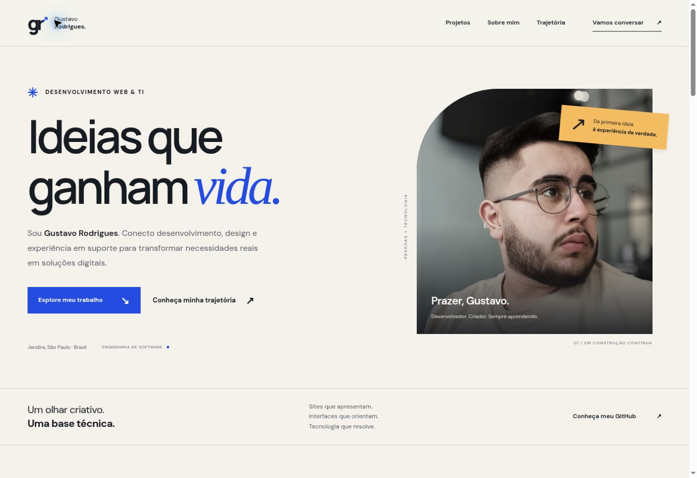

# Gustavo Rodrigues — Portfólio

Portfólio pessoal de desenvolvimento web e TI. A apresentação começa com projetos reais, relacionando cada entrega ao contexto do negócio, seguida por atuação, experiência e contato.

Endereço público: https://devgutz.github.io/Portfolio/

## Conceito

- Identidade editorial em grafite, azul, âmbar e fundo claro; retrato original do autor.
- Portal Universo Rodrigues em destaque e estudos dos projetos próprios Tech SP e 3D Studio.
- Estudos expansíveis com desafio, abordagem e entrega, sem métricas ou depoimentos inventados.
- Capturas já existentes identificadas como registros de versões anteriores, com links para os sites atuais.
- Experiência em suporte de TI, desenvolvimento e formação em Engenharia de Software.
- Contato por e-mail, WhatsApp, LinkedIn e formulário Formspree já utilizado no projeto.

## Estrutura e publicação

HTML, CSS e JavaScript em `index.html`, `assets/css/style.css` e `assets/js/app.js`. Imagens em `assets/img/`. Sem build nem dependências de execução. Publique a raiz no GitHub Pages, preservando caminhos relativos para `/Portfolio/`.

## Comportamento

Conteúdo e estudos de caso usam HTML nativo. Menu mobile com estado expandido, fechamento por Escape e retorno do foco. Formulário com validação nativa, bloqueio de envio simultâneo, timeout e preservação de texto em erros. Sucesso depende de resposta positiva do provedor. Inclui labels, status anunciado, foco visível, salto de navegação, imagens dimensionadas e respeito a movimento reduzido.

## Manutenção

Atualize casos e links em `index.html`. Confira a versão de cada captura antes de substituí-la. A conclusão do curso está prevista para 2028. Revise a experiência quando houver alteração.

O formulário mantém `https://formspree.io/f/mrelvobj`. A entrega real depende da configuração da conta no Formspree. Durante QA, intercepte a requisição para não enviar mensagens reais. Nenhum teste de interface comprova recebimento na caixa postal.

## Validação desta proposta

- `node --check assets/js/app.js` e `git diff --check`.
- `node tests/contact.cjs`: teste com DOM mínimo e provedor simulado, sem requisições reais. Verifica menu/Escape, formulário inválido, envio duplicado, sucesso confirmado e preservação de texto em falha. Não substitui QA de navegador.
- Inspeção visual desktop e viewports em iframe de 320, 390 e 768 px, sem rolagem lateral. Menu mobile, estudos de caso e validação nativa conferidos no navegador.
- Recursos locais e âncoras conferidos; sem envio real ao Formspree.

